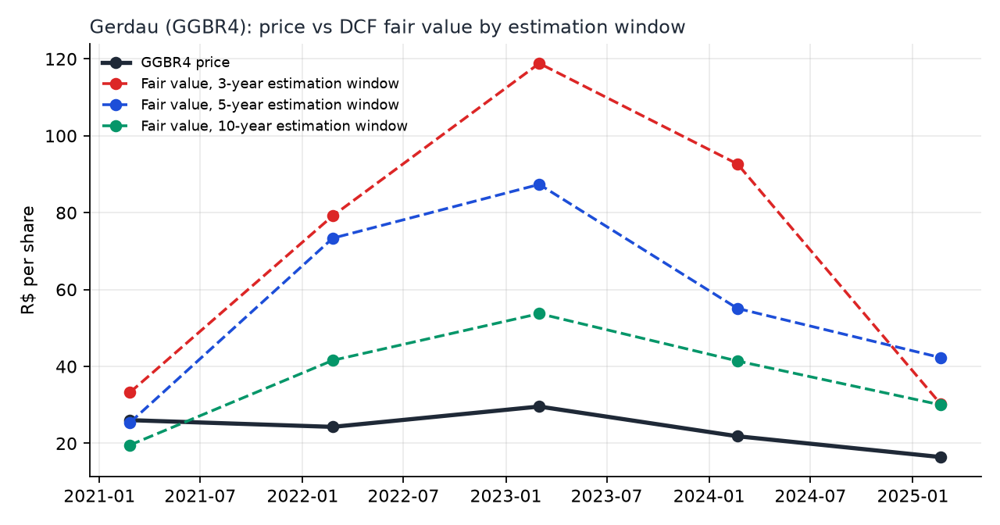

# valuation-gerdau

Four AI-assisted reviewers around my DCF thesis on Gerdau: they audit the data against public filings, rebuild the
numbers from raw statements, test alternative specifications and prepare the questions an examining board will ask.


## Results



| Check | Result | Source |
|---|---|---|
| Spreadsheet figures vs Gerdau's 4Q earnings releases (page and quoted line for each) | **20/20** match; extraction 20/20 against hand-checked figures | [reports/auditor.md](reports/auditor.md) |
| Spreadsheet lines vs raw CVM filings, 2015–2024 | **130/130** match | [reports/second_analyst.md](reports/second_analyst.md) |
| Independent model vs the thesis notebook | **15/15** current results, **45/45** first version | [golden/](golden/), [tests/test_model.py](tests/test_model.py) |
| WACC, 5-year window, first thesis version → now | 5.1–7.8% (below terminal growth) → **11.6–14.2%** | [final-report.pdf](final-report.pdf) |
| API cost of every run while building it | 28 calls, about **US$ 0.03** | `logs/` (tokens per call) |

The 3-year estimation window gives the highest fair values at the 2022–2023 steel peak, which is the pattern the
thesis question is about. Full write-up: [final-report.pdf](final-report.pdf).

## Run it

```bash
pip install -r requirements.txt
python demo.py
```

Runs the four reviewers in sequence on recorded model answers (no API key, no cost), prints what each one found and
rebuilds `final-report.pdf`. With a key (`cp .env.example .env`), `python -m valuation_gerdau all` calls the API and
`python -m valuation_gerdau final` rebuilds the PDF. Tests: `python -m pytest -q`.

## How it works

1. **Data.** Reads the thesis spreadsheet from [`tcc-valuation-gerdau`](https://github.com/gcabralcavalcanti/tcc-valuation-gerdau)
   through its raw link, and an independent FCFF/WACC model reproduces the thesis results.
2. **Data auditor.** Splits each earnings release into pages, picks the pages with the figures, and the LLM extracts
   them as JSON with page and quote. Code checks that the quote is on that page and contains the number.
3. **Second analyst.** Rebuilds the inputs from raw CVM filings, reconciles them line by line and recomputes the value
   changing one choice at a time (cost of debt, tax rate, equity income, country risk). The LLM writes the memo.
4. **Econometric lab.** Runs estimation windows, beta regression designs, equity premiums and cost-of-capital methods,
   and the LLM lists the options with pros and cons. It does not pick one.
5. **Assumption reviewer.** Places each assumption in Gerdau's own history and in the steel cycle, builds a tornado,
   and the LLM writes the board's likely questions with the numbers for each answer.
6. **Guards.** JSON Schema on every answer, closed lists for names, every number in the LLM text must exist in the
   tables it received, one retry with the reasons, call cap per run, recorded answers (never pay twice), JSON log per call.

## Data

All public: CVM open data (financial statements), Gerdau's earnings releases filed with the SEC, Yahoo Finance prices
(in the thesis spreadsheet), Banco Central (Focus survey, CDI), FRED (steel price index, Baa and Treasury yields),
Ipeadata (EMBI+ Brazil) and Robert Shiller's long-run US returns. The spreadsheet is not copied here; `recordings/`
keeps the model answers and the CVM lines already extracted so the demo runs offline from the large files.

## Limits

- The number check catches invented figures, not a real figure tied to the wrong date; the reports say so.
- EMBI+ Brazil was discontinued on 30/07/2024, so the February 2025 date uses that last value.
- Country risk uses the plain sovereign spread, not the spread scaled by relative volatility.
- The risk-free rate is the expected Selic from the Focus survey; a long government bond net of the sovereign spread
  is the next test.
- Earnings releases are web pages: "page" means the page breaks in the filed document.

## How AI was used

I use Claude (Claude Code and the API) for coding, review and documentation. The questions, modelling choices,
validation and conclusions are mine. Here the API is also part of the product: it reads documents and drafts text,
and code checks every answer.

## License

MIT. See [LICENSE](LICENSE).
